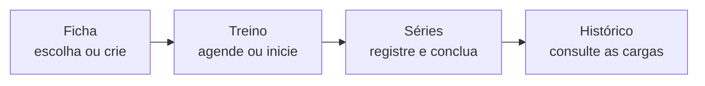
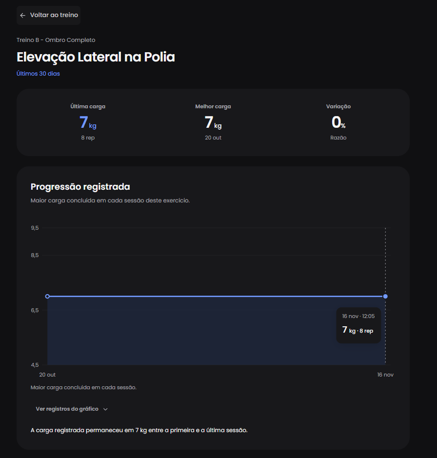
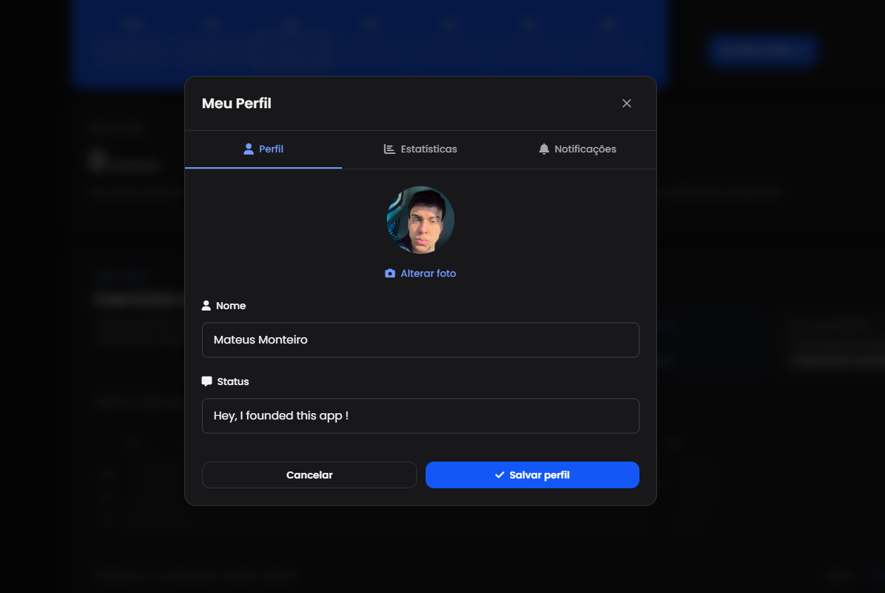
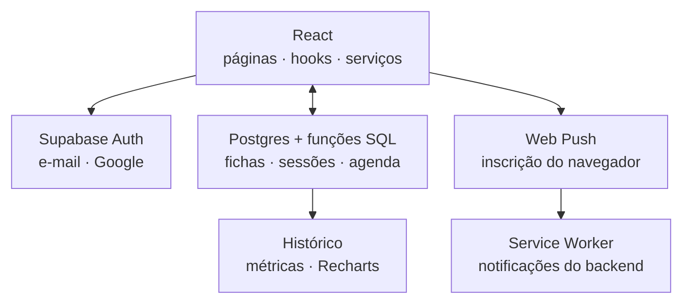

<p align="center">
  <picture>
    <source media="(prefers-color-scheme: dark)" srcset="public/assests/capa-escura.png">
    <source media="(prefers-color-scheme: light)" srcset="public/assests/capa-clara.png">
    
  </picture>
</p>

<h1 align="center">Gym.io</h1>

<p align="center">Sua ficha, o treino de hoje e o que você já fez.</p>

<p align="center">
  <a href="https://usegymio.vercel.app">Abrir aplicativo</a> ·
  <a href="#na-prática">Na prática</a> ·
  <a href="#recursos">Recursos</a> ·
  <a href="#como-rodar">Como rodar</a> ·
  <a href="#por-dentro-do-projeto">Código</a>
</p>

O Gym.io é um aplicativo web para organizar fichas de treino, registrar carga e repetições durante a sessão e consultar o histórico depois. Você pode começar com um treino do sistema ou montar o seu, separar os exercícios em seções e reservar um dia na agenda.

A versão publicada está hospedada na **Vercel**, em [usegymio.vercel.app](https://usegymio.vercel.app).

A interface funciona no celular e no desktop, com temas claro e escuro. As imagens abaixo são capturas do aplicativo; os números pertencem às sessões registradas na conta usada na demonstração.

## Na prática



### 1. Prepare a ficha

Em **Treinos**, escolha uma ficha do sistema para consultar ou crie um treino com nome, descrição e cor de identificação. Nos seus treinos, adicione seções, busque os exercícios pelo nome e defina séries e repetições. A tela de visualização reúne a estrutura inteira antes de começar.

<p align="center">
  
</p>

**Exemplo da captura:** o Treino A separa bíceps e tríceps em duas seções. A Rosca com Barra W aparece com três séries de dez repetições. Ao executar o treino, você registra o que fez em cada série.

### 2. Escolha o dia

Em **Treinar**, a agenda semanal mostra os treinos de cada dia. Você também pode escolher uma ficha no catálogo e começar diretamente, sem agendamento.

Para reservar um treino, selecione uma data e, se quiser receber lembretes, informe o horário de Brasília (`America/Sao_Paulo`). As opções são **no horário**, **um dia antes** e **dois dias antes**; todas começam desmarcadas. O horário é obrigatório quando há lembretes selecionados.

O agendamento pode ser concluído sem notificações. Para recebê-las, ative o recurso em **Perfil → Notificações** ou aceite a opção apresentada durante o agendamento. A permissão do navegador depende dessa escolha explícita.

### 3. Registre uma série por vez

Antes de iniciar, ajuste o descanso padrão. O player mostra o exercício atual, a série, a carga, as repetições e a orientação de execução, com GIF demonstrativo quando disponível no catálogo.

<p align="center">
  <a href="public/assests/treino-em-andamento.gif">
    
  </a>
  <br>
  <sub>O player durante o intervalo entre duas séries.</sub>
  <br>
  <a href="public/assests/treino-em-andamento.gif">Ver gravação em tamanho original</a>
</p>

| Durante a sessão | O que acontece |
| --- | --- |
| Registrar uma série | A carga e as repetições informadas são enviadas ao servidor. |
| Repetir um exercício | O preenchimento usa a última série confirmada da sessão; na falta dela, consulta o histórico e depois os valores da ficha. |
| Descansar | A contagem regressiva indica a próxima série. É possível adicionar 15 segundos ou pular o intervalo. |
| Pausar | A sessão fica pausada até você continuar. |
| Voltar ao aplicativo | O player consulta a sessão salva para recuperar o andamento confirmado. |
| Encontrar outro treino ativo | Você pode continuar a sessão existente ou cancelá-la antes de iniciar outra. |
| Finalizar antes do fim da ficha | Após a confirmação, o progresso realizado até ali é salvo. |

O andamento depende de conexão com o Supabase. A recuperação considera os registros confirmados pelo servidor; o aplicativo não oferece registro de séries offline.

### 4. Veja o que ficou registrado

O **Histórico** oferece os períodos **Mensal**, que considera os últimos 30 dias, e **Total**. Os indicadores resumem os treinos concluídos, a duração média e os exercícios registrados. O cartão **Dias de treino** sempre se refere à semana atual, desde domingo.

<p align="center">
  
</p>

| Visualização | Como ler |
| --- | --- |
| Maiores cargas | Compara a melhor carga registrada em séries concluídas de cada exercício. |
| Mais realizados | Conta em quantas sessões concluídas cada exercício apareceu. |
| Distribuição muscular | Mostra a participação das categorias nos exercícios concluídos, sem representar intensidade ou volume de carga. |
| Ritmo de treino | No período Mensal, mostra treinos, duração total ou exercícios ao longo do tempo. |
| Detalhe da sessão | Reúne os exercícios e as séries registrados naquele treino. |
| Evolução do exercício | Mostra a maior carga concluída em cada sessão, a última carga, a melhor marca e a variação no período. |

Os gráficos também oferecem tabelas para consultar os valores. Quando registros antigos estão incompletos, as métricas afetadas aparecem como parciais ou indisponíveis.

<p align="center">
  
  <br>
  <sub>Na captura, a carga permaneceu em 7 kg. O gráfico mostra a manutenção desse valor entre as sessões.</sub>
</p>

### 5. Acompanhe a rotina

O **Painel** reúne o próximo treino agendado, a atividade da semana, comparações do mês e do trimestre e um mapa anual de consistência. Cada dia do mapa representa os exercícios concluídos naquela data.

Em **Meu Perfil**, você pode alterar nome, foto e status, consultar as estatísticas da semana e gerenciar as notificações daquele navegador. A aba de estatísticas apresenta exercícios, séries, sequência de dias e duração média por sessão.

<p align="center">
  
</p>

## Recursos

| Área | Disponível no aplicativo |
| --- | --- |
| Conta | Cadastro e login com e-mail e senha, entrada com Google, opção de lembrar a sessão e redefinição de senha. |
| Fichas | Treinos do sistema para consulta e execução; criação, edição e exclusão dos treinos pessoais, com seções, séries, repetições e cor própria. |
| Agenda | Seleção por semana e dia, agendamento e remoção de treinos, com lembretes opcionais. |
| Execução | Registro por série, memória de carga e repetições, descanso ajustável, pausa, recuperação de sessão e finalização. |
| Progresso | Indicadores do histórico, gráficos, tabelas, distribuição muscular, evolução por exercício e mapa anual. |
| Perfil | Nome, foto, status, estatísticas semanais e controle de notificações por navegador. |
| Interface | Temas claro e escuro, navegação adaptada ao celular e ao desktop e suporte a movimento reduzido. |
| Páginas públicas | Apresentação do produto, autenticação, termos de uso e política de privacidade. |

### Notificações no dia a dia

Com o recurso configurado e autorizado, o aplicativo pode exibir a confirmação do agendamento, os lembretes escolhidos e uma notificação de treino concluído com acesso ao histórico. Durante a execução, séries e intervalos são acompanhados no player.

No iPhone e no iPad, adicione o Gym.io à **Tela de Início** e abra pelo ícone instalado para usar as notificações. A entrega e o som dependem do navegador, do sistema operacional e do serviço de envio do backend. É possível desativar o vínculo em **Perfil → Notificações**.

## Como rodar

Você precisa de **Node.js 22.12 ou superior**, npm e acesso a um projeto Supabase compatível com os serviços deste código.

> Este repositório contém o frontend. O schema completo, as funções SQL e os dados iniciais do Supabase não estão incluídos nesta cópia. Um projeto Supabase vazio não é suficiente para executar os fluxos autenticados; obtenha o backend correspondente com o mantenedor.

### 1. Instale as dependências

```sh
git clone https://github.com/MateusMonteiro11/gym.io.git
cd gym.io
npm ci
```

### 2. Configure o ambiente

Configure as variáveis de ambiente com os dados do backend correspondente. No desenvolvimento local, elas podem ficar em `.env.local`; na Vercel, ficam nas configurações do projeto.

| Variável | Uso |
| --- | --- |
| `VITE_SUPABASE_URL` | URL do projeto Supabase. Obrigatória. |
| `VITE_SUPABASE_PUBLISHABLE_KEY` | Chave pública do cliente Supabase. Obrigatória. |
| `VITE_SUPABASE_REDIRECT_URL` | Destino do e-mail de recuperação de senha. Sem ela, o código usa `/redefinir-senha` na origem atual. |
| `VITE_VAPID_PUBLIC_KEY` | Chave pública do Web Push. Sem ela, a ativação de notificações fica indisponível. |

As variáveis `VITE_*` são incluídas no código entregue ao navegador. Use a [chave publicável do Supabase](https://supabase.com/docs/guides/getting-started/api-keys); chaves secretas e `service_role` pertencem apenas ao backend. O arquivo `.env.local` é ignorado pelo Git.

No Supabase Auth, habilite e-mail/senha e configure o Google caso queira usar a entrada social. Cadastre `http://localhost:5173/dashboard` e `http://localhost:5173/redefinir-senha` entre as [URLs de redirecionamento permitidas](https://supabase.com/docs/guides/auth/redirect-urls). Em produção, use as URLs correspondentes ao domínio publicado e ajuste o destino da recuperação de senha.

### 3. Inicie o frontend

```sh
npm run dev
```

Abra [localhost:5173](http://localhost:5173). Se a porta estiver ocupada, o Vite informa outra URL no terminal; atualize os redirecionamentos de autenticação para essa origem. Reinicie o servidor ao alterar as variáveis de ambiente.

### Comandos disponíveis

| Comando | Finalidade |
| --- | --- |
| `npm run dev` | Inicia o servidor de desenvolvimento. |
| `npm run build` | Gera os arquivos de produção em `dist/`. |
| `npm run preview` | Serve o build localmente para conferência. |
| `npm test` | Executa `node --test`. Esta cópia não inclui arquivos de teste. |

A hospedagem atual usa a **Vercel**. Para gerar a versão de produção, execute `npm run build`; a saída fica em `dist/`. Configure as variáveis de ambiente antes do build. As rotas precisam retornar `index.html` ao serem abertas diretamente; o [vercel.json](vercel.json) já define essa reescrita. O envio de lembretes exige que o serviço correspondente esteja implantado e ativo no backend.

## Por dentro do projeto

O frontend é uma SPA em React. As páginas usam hooks para controlar os fluxos e serviços para acessar o Supabase. O estado confirmado de uma sessão de treino fica no servidor, enquanto os gráficos são preparados a partir dos registros do histórico.



### Tecnologias

As versões declaradas estão no [package.json](package.json) e as resolvidas no [package-lock.json](package-lock.json).

| Tecnologia | Papel no projeto |
| --- | --- |
| React 18 + JavaScript | Interface, componentes e contextos de autenticação, tema e feedback. |
| Vite 8 | Desenvolvimento e build. |
| React Router 7 | Navegação e proteção das rotas autenticadas. |
| Tailwind CSS 4 + CSS | Layouts responsivos, tokens de tema e estilos das áreas pública e autenticada. |
| Supabase JS 2 | Autenticação, consultas ao Postgres e chamadas de funções SQL. |
| Recharts 3 | Gráficos do histórico e evolução de carga. |
| Framer Motion | Transições e animações da interface. |
| Three.js + React Three Fiber | Cena 3D da página de apresentação. |
| React Aria Components + Lucide | Controles de interface e ícones. |
| Web Push + Service Worker | Recebimento e apresentação de notificações no navegador. |

### Organização

```text
gym.io/
├── public/
│   ├── assests/              # Capturas, capas e GIF deste README
│   ├── gifs/                 # Demonstrações dos exercícios
│   ├── manifest.webmanifest  # Apresentação do app instalado
│   └── push-sw.js            # Service Worker de notificações
├── src/
│   ├── assets/images/        # Imagens usadas pela interface
│   ├── components/           # Player, perfil, agenda, navegação e UI
│   ├── contexts/             # Autenticação, tema e feedback global
│   ├── features/
│   │   ├── auth/             # Interface e fluxos de autenticação
│   │   ├── history/          # Consultas, métricas, gráficos e tabelas
│   │   ├── landing/          # Apresentação e cena 3D
│   │   └── publicSite/       # Elementos públicos e documentos legais
│   ├── hooks/                # Sessão ativa, timers, agenda e dados
│   ├── layouts/              # Estrutura da área autenticada
│   ├── lib/                  # Cliente Supabase
│   ├── pages/                # Telas associadas às rotas
│   ├── routes/               # Roteador e proteção de acesso
│   ├── services/             # Acesso a dados por domínio
│   ├── styles/               # Estilos globais e temas
│   └── utils/                # Datas, duração, métricas e validações
├── index.html
├── package.json
├── vercel.json
└── vite.config.js
```

<details>
<summary><strong>Rotas e pontos de entrada no código</strong></summary>

| Rota | Tela | Acesso |
| --- | --- | --- |
| `/` | Apresentação do produto | Público |
| `/login`, `/cadastro` | Entrada e criação de conta | Público |
| `/redefinir-senha` | Recuperação de senha | Link enviado por e-mail |
| `/termos`, `/privacidade` | Documentos legais | Público |
| `/dashboard` | Painel e consistência anual | Autenticado |
| `/treinos` | Biblioteca e fichas pessoais | Autenticado |
| `/treinos/visualizar/:id` | Estrutura da ficha | Autenticado |
| `/treinos/editar`, `/treinos/editar/:id` | Editor de treino | Autenticado |
| `/treinar` | Agenda e catálogo para iniciar | Autenticado |
| `/treinar/:id` | Player | Autenticado |
| `/historico` | Indicadores, sessões e evolução | Autenticado |

Para seguir um fluxo no código, comece por [AppRoutes.jsx](src/routes/AppRoutes.jsx). O player é controlado por [useTreinoAtivo.js](src/hooks/useTreinoAtivo.js), com operações em [treinoSessaoService.js](src/services/treino_ativo/treinoSessaoService.js). As regras dos indicadores ficam em [historyModel.js](src/features/history/historyModel.js), e as consultas em [historyRepository.js](src/features/history/historyRepository.js).

</details>

<details>
<summary><strong>Contrato esperado do backend Supabase</strong></summary>

Os serviços atuais consultam `usuarios`, `treinos`, `secoes_treino`, `treinos_exercicios`, `exercicios`, `categorias_musculares`, `agendamentos`, `treino_sessoes`, `treino_sessao_series`, `historico_treinos` e `historico_exercicios`. As relações e políticas de acesso precisam corresponder às consultas implementadas.

| Domínio | Funções SQL chamadas pelo frontend |
| --- | --- |
| Início e séries | `iniciar_treino_sessao`, `concluir_treino_serie` |
| Pausa e descanso | `definir_pausa_treino_sessao`, `encerrar_descanso_treino_sessao`, `ajustar_descanso_treino_sessao` |
| Avanço e encerramento | `avancar_exercicio_treino_sessao`, `finalizar_treino_sessao`, `cancelar_treino_sessao` |
| Memória do exercício | `buscar_memorias_exercicios` |
| Agenda | `agendar_treino_com_lembretes` |
| Web Push | `consultar_push_subscription`, `registrar_push_subscription`, `remover_push_subscription` |

As alterações de uma sessão enviam a revisão esperada para que o servidor detecte conflitos. Os arquivos de serviço documentam os nomes e argumentos usados; eles não substituem o schema ou as implementações SQL. Os dados pessoais dependem das políticas de acesso do backend, além da proteção de rotas no frontend.

</details>

## Contribuições e autoria

Para sugerir uma mudança ou relatar um problema, abra uma [issue](https://github.com/MateusMonteiro11/gym.io/issues). Inclua a tela, os passos para reproduzir e o comportamento esperado. Em mudanças de interface, acrescente capturas no celular e no desktop; em mudanças no player, descreva o efeito sobre a sessão e seus registros.

Desenvolvido por [Mateus Monteiro](https://github.com/MateusMonteiro11). O projeto tem finalidade acadêmica e educacional. Esta cópia não inclui um arquivo `LICENSE` com uma licença de distribuição definida.
