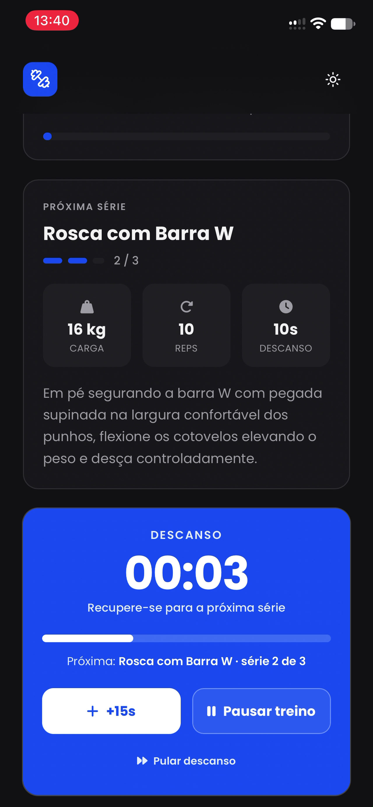
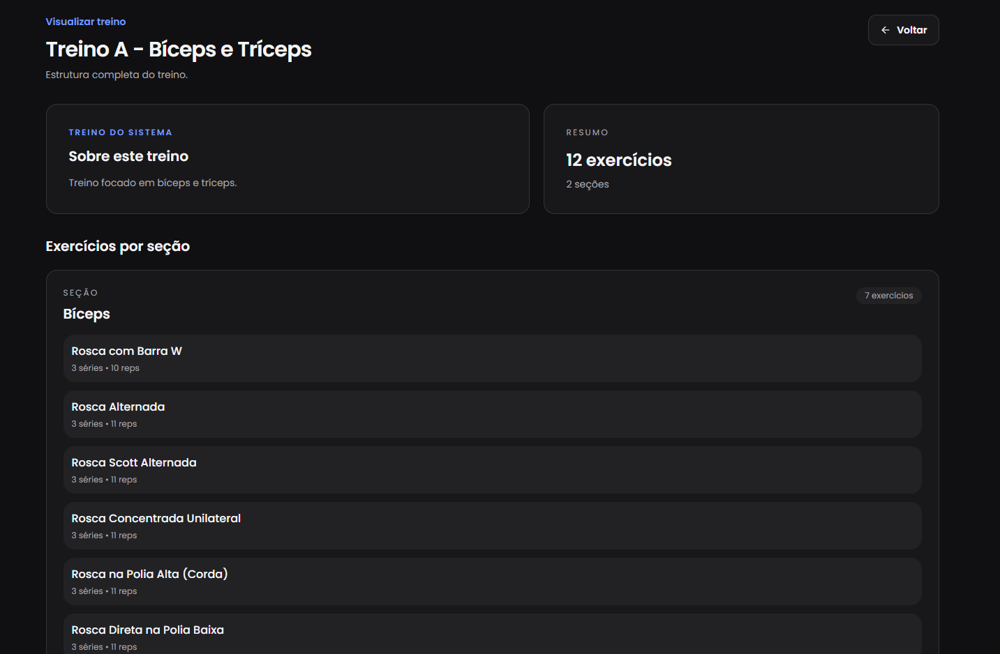
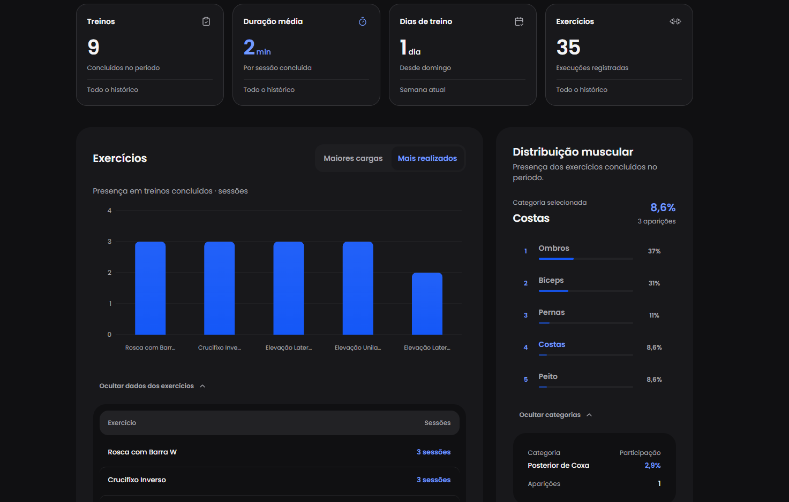

# Gym.io

Organize suas fichas, registre cada série e acompanhe suas cargas.

**[Acessar o aplicativo ↗](https://usegymio.vercel.app)**

<table>
  <tr>
    <td width="36%" align="left" valign="top">
      
    </td>
    <td valign="top">
      <h3>Durante o treino</h3>
      
Carga, repetições e descanso na mesma tela.

      <ul>
        <li>Registre cada série.</li>
        <li>Ajuste ou pule o descanso.</li>
        <li>Pause e retome a sessão.</li>
      </ul>
      <h3>Na sua rotina</h3>
      
Escolha uma ficha pronta ou monte a sua. Agende os treinos e consulte seus registros depois.

      
Disponível no celular e no computador, com temas claro e escuro.

    </td>
  </tr>
</table>

## Treinos

Exercícios organizados por seção, com séries e repetições definidas na ficha.

## Histórico

Sessões concluídas, cargas registradas e distribuição dos exercícios por grupo muscular.

---

Desenvolvido por [Mateus Monteiro](https://github.com/MateusMonteiro11) · Hospedado na Vercel.
